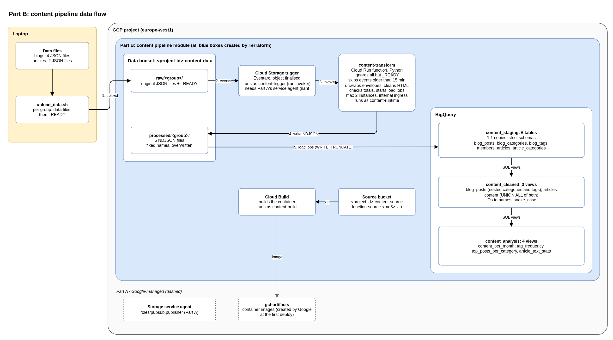

# GCP content intelligence platform: planning

This repository plans a new portfolio project. It takes an earlier local project ([Wix Content Intelligence Pipeline](https://github.com/beatanemeth/Wix-Content-Intelligence-Pipeline)) and redesigns it as a cloud data pipeline on **Google Cloud**, built with **Terraform**.

Every implementation detail lives in the [implementation repository](https://github.com/beatanemeth/gcp-content-intelligence-platform_implementation); this repository designs it.

> **Authorship note:** Plan and decisions are mine. Claude Code helped with research and wording.

 

## Starting point

[Wix Content Intelligence Pipeline](https://github.com/beatanemeth/Wix-Content-Intelligence-Pipeline) is a local-first Data Science project. It processed blog and article exports with Docker and Jupyter on a laptop.

The new project keeps the data structure but changes the focus:

- **From** local analysis and presentation **to** cloud infrastructure and Data Engineering.
- **From** notebooks **to** Terraform, a Cloud Run function and BigQuery.
- **From** real Wix data **to** a fictional dataset with the same structure.

 

## Architecture

 

## Key decisions

- **Part A and Part B:** the pipeline is a standalone Terraform module, added to an existing GCP platform. It only adds its own resources and permissions; it changes nothing in Part A ([step 0](rebuild_plan/step-0_overview.md)).
- **2 buckets:** data and source. The runtime account writes data, so it is kept apart from the code ([step 2](rebuild_plan/step-2_terraform-skeleton.md)).
- **Python cleans, SQL transforms:** Python only unwraps the exports and cleans the HTML. Joins, renames and calculations are SQL in BigQuery, where they stay visible and testable ([step 3](rebuild_plan/step-3_python-cleaning.md)).
- **3 layers in BigQuery:** staging tables with strict schemas, then cleaned views, then analysis views. A wrong type fails the load loudly ([step 4](rebuild_plan/step-4_bigquery-staging.md)).
- **3 service accounts, no keys:** one identity per job (build, trigger, runtime), each role on the smallest scope that works ([step 5a](rebuild_plan/step-5a_service-accounts.md)).
- **Upload from the laptop, a `_READY` marker last:** each group of files is processed once, not once per file ([step 5b](rebuild_plan/step-5b_function-and-trigger.md)).
- **Views, not Dataform or dbt:** 7 views that store nothing need no extra tool at this size ([step 7](rebuild_plan/step-7_analysis-views.md)).
- **Simulation first:** a mocked Google provider, a BigQuery emulator and fake cloud clients. The real deployment needs no code change ([step 9](rebuild_plan/step-9_real-deployment.md)).

 

## Planning flow

The plan has four stages. Each stage builds on the one before. Each stage ends in a README that summarises its results.

Stages 1 to 3 are kept in `history/`. New ideas often came after an overnight rest, so each stage revisits the one before. **Stage 4, `rebuild_plan/`, is the current plan.**

1. **[history/v1_brainstorming/](history/v1_brainstorming/):** the first discussion with Claude Code.
   - **[history/v1_brainstorming/README.md](history/v1_brainstorming/README.md):** all brainstorming decisions in one place.
2. **[history/v2_architecture/](history/v2_architecture/):** the plan for the standalone Terraform module.
   - **[history/v2_architecture/README.md](history/v2_architecture/README.md):** a summary of the module plan.
3. **[history/v3_review_plan/](history/v3_review_plan/):** the review of each architecture step, with refinements and the final implementation details.
   - **[history/v3_review_plan/README.md](history/v3_review_plan/README.md):** an index of the reviewed steps.
4. **[rebuild_plan/](rebuild_plan/):** a clean, step-by-step build plan for the pipeline, with the lessons of a first build already included. It needs no other file in this repository.
   - **[rebuild_plan/README.md](rebuild_plan/README.md):** the project in short, how to use the plan, and the steps.

**Supporting folders:** `assets/` (diagrams), `dummy_data_blogs/` and `dummy_data_articles/` (the dummy dataset).
