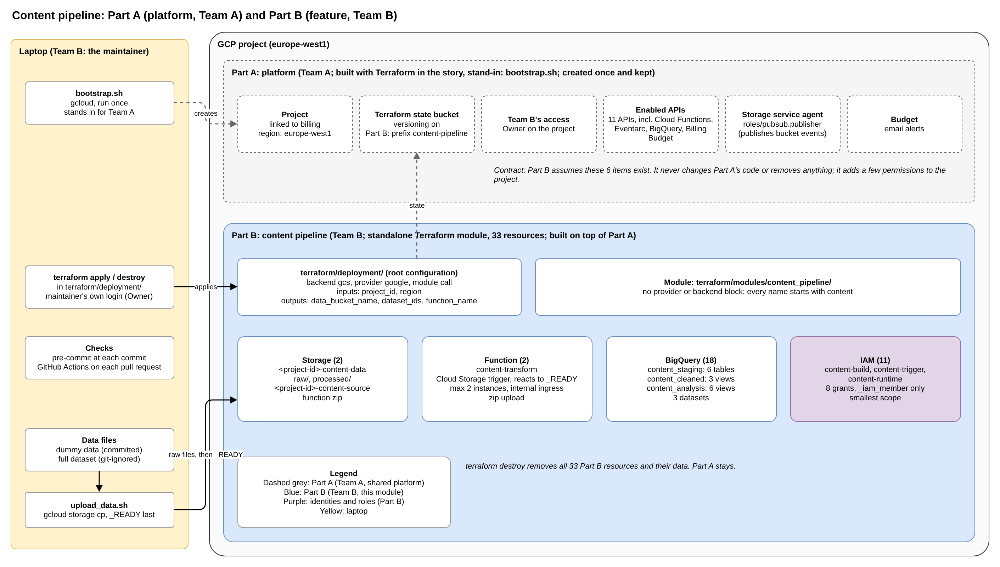
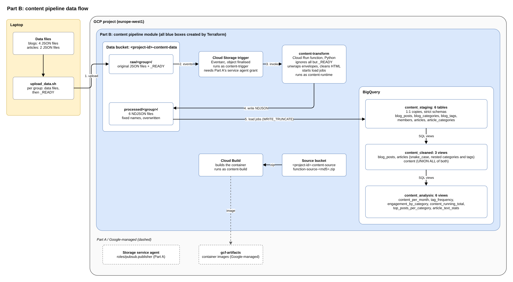

# Content pipeline: planning summary

## The story

This Terraform setup is a new feature in an "existing infrastructure": a standalone Terraform module.

"Existing infrastructure" means something already built, so the demo can tell the story in two acts:

- **Part A: platform.** The shared foundation, applied once and kept.
- **Part B: feature.** The content pipeline as a standalone module, added to Part A without changing it. Anything shared goes in Part A; anything pipeline-specific stays in Part B.

**_Part A stays imaginary._** Its only job is to tell Part B what it can assume already exists. A `gcloud` bootstrap script stands in for it.

**Part A** (_the platform_) provides five things. **Part B** (_the pipeline_) uses them, but never creates or changes them:

1. The GCP project, linked to billing, with its region policy (`europe-west1`)
2. The Terraform state bucket
3. The enabled APIs
4. The Cloud Storage service agent's permission to publish events
5. The billing budget and its alerts

**Part B** creates everything that only the **pipeline** uses: buckets, the function and its trigger, BigQuery datasets, tables and views, and its own service accounts with their roles. Both the module and the folder that deploys it (`terraform/deployment/`) belong to Part B.

 

## The pipeline in one flow

1. **Upload:** `scripts/upload_data.sh` copies the raw JSON files of a group to `raw/<group>/` in the data bucket, then a `_READY` marker last.
2. **Trigger:** every new file fires an event. The function ignores everything except `_READY`.
3. **Transform (Python):** on `_READY`, the function unwraps the envelopes, cleans the HTML in articles and writes one NDJSON file per raw file to `processed/<group>/`.
4. **Load:** the same run starts one BigQuery load job per file into `content_staging`, replacing the table's contents.
5. **Model (SQL):** views in `content_cleaned` and `content_analysis` compute the final shape and the analysis at query time.
6. **Tear down:** `terraform destroy` removes everything. The files on the laptop are the source of truth.

| Layer         | Where                      | Format                                          | Created by        |
| ------------- | -------------------------- | ----------------------------------------------- | ----------------- |
| **Raw**       | Bucket `raw/`              | Original JSON files                             | Upload script     |
| **Processed** | Bucket `processed/`        | NDJSON, envelopes removed, HTML cleaned         | Function (Python) |
| **Staging**   | Dataset `content_staging`  | 6 tables, 1:1 copies, original field names      | Load jobs         |
| **Cleaned**   | Dataset `content_cleaned`  | 3 views: snake_case, categories and tags nested | Terraform (SQL)   |
| **Analysis**  | Dataset `content_analysis` | 6 views, one per question                       | Terraform (SQL)   |

 

## What Part B creates

| Group         | Resources                                                                                 | Count  |
| ------------- | ----------------------------------------------------------------------------------------- | ------ |
| Storage       | Data bucket, source bucket                                                                | 2      |
| Function code | Zip upload (the zip itself is built locally by a data source)                             | 1      |
| Function      | `content-transform`, with its Cloud Storage trigger                                       | 1      |
| BigQuery      | 3 datasets, 6 staging tables, 9 views                                                     | 18     |
| IAM           | 3 service accounts (`content-build`, `content-trigger`, `content-runtime`), 8 role grants | 11     |
| **Total**     |                                                                                           | **33** |

**Module interface:** 3 inputs (`project_id`, `region`, `labels`), 3 outputs (`data_bucket_name`, `dataset_ids`, `function_name`).

 

## Key decisions

| Topic                   | Decision                                                       | Why                                                                                | ID          |
| ----------------------- | -------------------------------------------------------------- | ---------------------------------------------------------------------------------- | ----------- |
| **Ownership**           | Shared goes to Part A; pipeline-specific goes to Part B        | Part A never changes when a feature is added                                       | S1.1        |
| **APIs**                | Part A enables them                                            | An API is a project-wide switch; Part B's `destroy` could switch it off for others | S1.4        |
| **Data upload**         | `gcloud storage cp`, not Terraform                             | Terraform builds infrastructure; a script moves data. `apply` has no side effects  | D1.2        |
| **Complete groups**     | A `_READY` marker, uploaded last, starts the processing        | Storage fires one event per file; the marker proves the group is complete          | D1.9        |
| **Idempotency**         | Every step overwrites; loads use `WRITE_TRUNCATE`              | Events can arrive twice; running twice gives the same result                       | D1.10       |
| **Python vs SQL**       | Python only reshapes and cleans HTML; SQL does all joins (ELT) | Each tool does what it does best; logic stays readable in the warehouse            | D2.2        |
| **Views, not tables**   | Cleaned and analysis layers are views                          | 570 KB of data; no rebuild step to forget                                          | D2.4, D3.13 |
| **Strict staging**      | Typed columns; any unexpected field fails the load             | A failed load is visible at once; a lenient one hides errors                       | D3.9        |
| **Naming**              | Every name starts with `content`                               | Other features share the project; `staging` would clash                            | S2.2        |
| **Module boundary**     | No `provider` or `backend` block in the module                 | The caller decides the project, credentials and state                              | S2.8        |
| **Terraform to Python** | Names passed to the function as environment variables          | Each name is written once, in Terraform                                            | S3.9        |
| **`for_each`**          | One block per group of identical resources, keyed by a map     | Less repetition; a map keeps items stable, `count` renumbers them                  | S3.4        |
| **Service accounts**    | One per job (build, trigger, runtime), smallest scope          | Each account's roles fit one sentence: least privilege                             | S4.1, S4.2  |
| **IAM resources**       | `_iam_member` only                                             | Adds a grant without removing anyone else's                                        | S4.3        |
| **`depends_on`**        | Only for the function and the view blocks                      | Terraform cannot see IAM grants in use or table names inside SQL                   | S5.1        |
| **CI**                  | Offline checks only: `fmt`, `validate`, TFLint, pytest         | No cloud credentials in GitHub; nothing in CI can change the cloud                 | S7.1        |
| **Build order**         | Test each piece on its own before automating it                | Each phase adds one new source of errors                                           | S8.1, S8.2  |

 

## Where to read more

| File                                                 | Content                                                 |
| ---------------------------------------------------- | ------------------------------------------------------- |
| [brainstorming/README.md](../brainstorming/README.md) | Pipeline decisions from the brainstorming (D0 to D7) |
| [00_roadmap.md](00_roadmap.md)                       | Planning steps; root configuration and module explained |
| [01_platform-contract.md](01_platform-contract.md)   | Step 1: what Part A provides; API list                  |
| [02_module-interface.md](02_module-interface.md)     | Step 2: inputs, outputs, naming, labels, versions       |
| [03_resource-inventory.md](03_resource-inventory.md) | Step 3: every resource with its key arguments           |
| [04_iam.md](04_iam.md)                               | Step 4: service accounts and roles                      |
| [05_dependencies.md](05_dependencies.md)             | Step 5: creation order, first `apply`, `destroy`        |
| [06_repository-layout.md](06_repository-layout.md)   | Step 6: folder tree of the implementation repository    |
| [07_ci.md](07_ci.md)                                 | Step 7: GitHub Actions, TFLint                          |
| [08_build-phases.md](08_build-phases.md)             | Step 8: 10 build phases and the runbook                 |
| [architecture.drawio](../assets/gcp-intelligence-platform/architecture.drawio) | Editable source of both diagrams (2 pages)              |

**Status:** most step decisions are _Delegated_ (chosen by Claude at the maintainer's request). Each becomes _Agreed_ once the maintainer can explain it in their own words.
