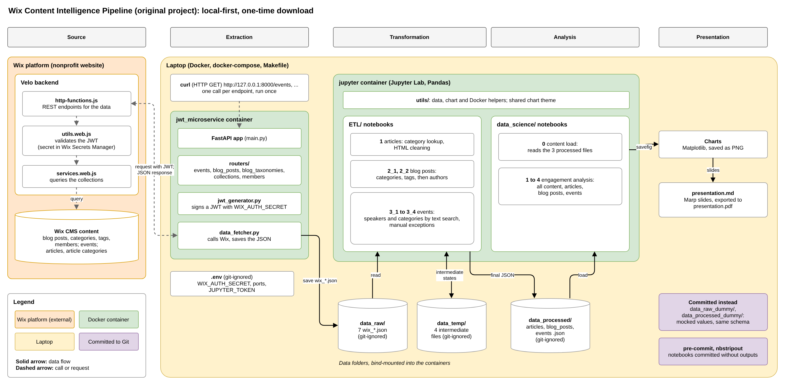

# Background

## Wix Content Intelligence Pipeline

ORIGINAL PROJECT  
GitHub repo: [Wix Content Intelligence Pipeline](https://github.com/beatanemeth/Wix-Content-Intelligence-Pipeline)

### Aim

- Its aim was to practise a Data Science mindset.
- End product: a presentation as a data scientist would give.
- Local-first approach with Docker, prioritising open-source tools.

### How does it work

1. The JWT/FastAPI microservice, operating from the laptop, calls the Wix Velo API endpoint (POST req).
   - The raw data is fetched as a JSON file and stored locally on the laptop in the same format. For simplicity, it is a one-time download.

2. Raw data is transformed locally with Jupyter. During the process, some states of the intermediate data, because of its complexity, were also stored locally in JSON format.
3. The transformed data is stored as a JSON file on the laptop.
4. Data Science analyses are done with Jupyter locally. Pandas was used to create charts for the presentation.

### Data

- Real data from the Wix website of a non-profit organisation for which I was the administrator at the time.

 

## GCP content intelligence platform

CURRENT PROJECT

### Aim

- Redesigns the "Wix Content Intelligence Pipeline" project as a cloud data pipeline on **Google Cloud**, built with **Terraform**.

### How it is supposed to work

1. Raw data is uploaded to the cloud. For simplicity, it is a one-time process.
2. Data transformation is done in the cloud.
3. Transformed data is stored in the cloud.
   - Some SQL is done with the transformed data in the cloud.

4. (Optional:) Visualisation in Looker Studio.

### Data

- A fictional dataset with the same structure as the original Wix exports.
- The project covers blogs and articles only from the original project; events data is out of scope (_see the decision below_).
- The raw files keep their API envelopes, and the article files also keep the embedded HTML; handling that mess is part of the pipeline.

#### Scope decision: events data

Events data is **out of scope**.  
The project covers blogs and articles only from the original setup.

What events would have added:

- A deeply nested structure (`location.address.location`, `dateAndTimeSettings`, `summaries.rsvps`).
- A recursive rich-content tree (`description.nodes`): the strongest case for Python.
- Coordinates for BigQuery `GEOGRAPHY`, time zones, RSVP counts.

Why excluded:

- **Fictional dataset effort:** the original events data is 7.5 MB and contains 123 records. A fictional replacement, including nested description trees and coordinates, is far more work than the blogs and articles were.
- **Judgement-based transformation:** the original notebooks inferred speakers and categories by text search, manual exceptions by event ID, and fallbacks. An automated pipeline would need these rules as mapping tables in Git: extra scope.

 

## Requirements and open questions

- **Tech stack:** Terraform, GCP, GitHub Actions and some SQL; Python where it is reasonable.
- **Simple and cost-effective:** the design should be as simple as possible.
- **Short-lived:** the GCP setup is created when needed and destroyed afterwards; it does not stay in the cloud permanently.
- **Public repository:** the full dataset is not committed, only dummy data. How can the transformation and SQL code be written if the full dataset is not in the repository?
- **Local testing:** how could the GCP setup be tested locally?
- **CI:** a GitHub Action runs a Terraform linter, formatter and validator on every commit to a branch.
- **Step by step:** the project is planned and built step by step; each concept is understood before the next one is added.
