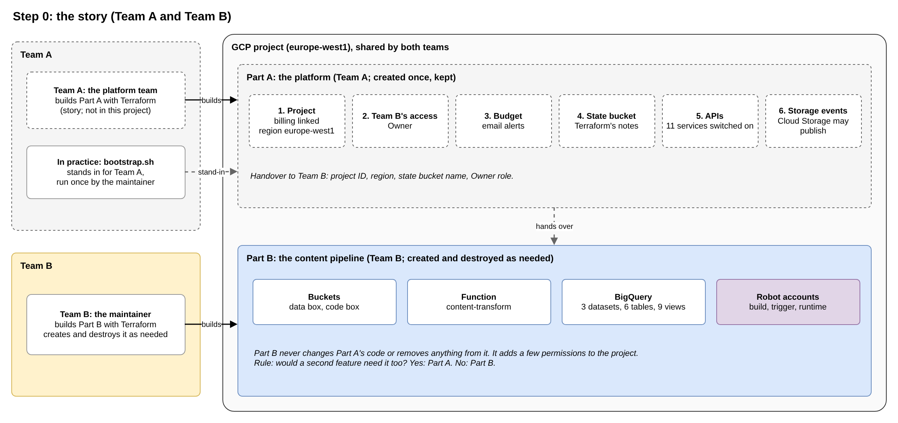

# Story overview

The story behind the project, the setup of Part A, and the access Team A grants to Team B. Agreed during the plan review.

**Scope:** Part A is not built in this project. It exists as a story; a stand-in script creates its elements for the demo (see [In practice: the stand-in](#in-practice-the-stand-in)).

 

## The story

A company runs its cloud work on GCP. Two teams share one project.

| Team       | Owns                             | Builds it with | Lifetime                        |
| ---------- | -------------------------------- | -------------- | ------------------------------- |
| **Team A** | **Part A:** the platform         | Terraform      | Created once, kept              |
| **Team B** | **Part B:** the content pipeline | Terraform      | Created and destroyed as needed |

- **The maintainer is Team B only.** Team A is other people: the platform team.
- **Team B asks; Team A grants.** Team B states what the pipeline needs. Team A creates the shared foundation and grants Team B the access to build on it.
- **Part B is added without changing Part A's code or removing anything from it.** Part B adds a few permissions to the project (for example, the right to start BigQuery jobs) for its own service accounts.
- **Ownership rule (S1.1):** "Would a second feature need the same thing?" Yes: Part A. No: Part B.
- **Simplest scenario:** one project, one region, one Team B member with `Owner`.

 

## Part A: elements

| #   | Element                                                   | Why it is needed                                                                 |
| --- | --------------------------------------------------------- | -------------------------------------------------------------------------------- |
| 1   | **Project** with billing linked and region `europe-west1` | Every resource, permission and cost belongs to a project; billing enables paid services; one region keeps all data in one place (EU data residency) |
| 2   | **Team B's access:** `Owner` on the project               | Team B must be allowed to create Part B's resources (see [Access granted to Team B](#access-granted-to-team-b)) |
| 3   | **Budget** with email alerts                              | Cost guard for the project                                                       |
| 4   | **Terraform state bucket**                                | Terraform records what it built, so it can update or delete it later             |
| 5   | **APIs** enabled                                          | Each GCP service must be enabled in the project before use                       |
| 6   | **Cloud Storage service agent:** `roles/pubsub.publisher` | Cloud Storage can publish "new file" events; any file-triggered feature needs it |

**Left out:**

- **Organisation and folders:** they group many projects; one project needs neither.
- **VPC network:** serverless services (Cloud Run functions, BigQuery) need no network of their own.
- **Groups:** access is granted to Team B's member directly; a Google group would be the production choice.
- **Separate development and production projects:** one deployment (S1.10).

 

## Part A: how Team A built it (story)

Team A built Part A with its own Terraform root configuration, separate from Part B's. Its code is not part of this project.

| Element             | Terraform resource                                                           | Key settings                                                                |
| ------------------- | ---------------------------------------------------------------------------- | --------------------------------------------------------------------------- |
| 1. Project          | `google_project`                                                             | Project ID, billing account; no organisation or folder                      |
| 2. Team B's access  | `google_project_iam_member`                                                  | `roles/owner` for Team B's member                                           |
| 3. Budget           | `google_billing_budget`                                                      | Small monthly amount; email alerts at 50 %, 90 % and 100 % (D4.19)          |
| 4. State bucket     | `google_storage_bucket`                                                      | Versioning on, uniform bucket-level access, public access prevention (S1.3) |
| 5. APIs             | `google_project_service`, one per API (`for_each`)                           | The 10 APIs of S1.4, plus the Billing Budget API                            |
| 6. Service agent    | `data "google_storage_project_service_account"`, `google_project_iam_member` | `roles/pubsub.publisher` for the agent's email                              |

- **Region:** a variable in Part A (`europe-west1`), passed to Team B as a value. Without an organisation, no policy can enforce it; it is an agreement.
- **Budget alerts:** sent to the billing account's administrators, which is Team A.
- **Part A's own state:** Terraform needs a state bucket before it creates anything, and Part A creates that bucket. Team A applied first with local state, then moved the state into the new bucket (`terraform init -migrate-state`, prefix `platform`). Part B stores its state in the same bucket under its own prefix, `content-pipeline` (S2.8).

### Handover to Team B

| Value             | Used by Team B for                |
| ----------------- | --------------------------------- |
| Project ID        | `terraform.tfvars` (`project_id`) |
| Region            | `terraform.tfvars` (`region`)     |
| State bucket name | `backend.hcl` (`bucket`)          |
| `Owner` role      | Deploying and running Part B      |

The handover values are outputs of Part A's root configuration.

 

## Access granted to Team B

Team A grants Team B's member `Owner` on the project.

- **Why `Owner`:** the simplest grant. One role covers every Part B resource (buckets, function, BigQuery, service accounts, role grants) and every runbook task (upload, `bq load`, queries, logs).
- **Trade-off:** `Owner` also lets Team B change or delete Part A's elements. The contract holds by agreement, not by permission.
- **Production alternative:** predefined roles per service instead of `Owner` (for example Storage Admin, BigQuery Admin, Cloud Functions Developer, Service Account Admin and User, Project IAM Admin), granted to a Google group.

 

## In practice: the stand-in

Part A is out of scope, but Part B needs its elements to exist in GCP. A stand-in script creates them once, outside the story.

| Topic              | Story              | Demo                                                                 |
| ------------------ | ------------------ | -------------------------------------------------------------------- |
| Who creates Part A | Team A             | The maintainer, once, with the stand-in                              |
| Tool               | Team A's Terraform | `bootstrap/bootstrap.sh` (`gcloud`, S1.9)                             |
| Result             | The 6 elements     | The same 6 elements                                                  |
| Team B's access    | `Owner`            | `Owner`, which comes with creating the project; no grant in the script |

- **Why a script and not Terraform:** Part A is not in scope; the stand-in only has to produce its result. A script needs no state and no state migration.
- **Story and demo match:** Team B holds `Owner` in both, so the README needs no note about an access gap.

 

## Changes to the plan

| Plan item                                         | Was                                            | Now                                                                        |
| ------------------------------------------------- | ---------------------------------------------- | -------------------------------------------------------------------------- |
| Story (`architecture/README.md`, `00_roadmap.md`) | Part A imaginary; one maintainer               | Team A built Part A with Terraform (story); the maintainer is Team B only  |
| S1.9, D4.1                                        | `gcloud` bootstrap script as Part A's stand-in | Unchanged; the story adds that Team A uses Terraform                       |
| S4.5                                              | The maintainer holds `Owner` (Part A)          | Unchanged in effect; framed as Team A's grant to Team B                    |
| Contract list (S1.2 to S1.7)                      | 5 items                                        | 6 items (Team B's access added)                                            |

 

## Decisions

- **Team B's access:** `Owner` (simplest).
- **Stand-in:** `bootstrap/bootstrap.sh`, as planned (phase 1).
