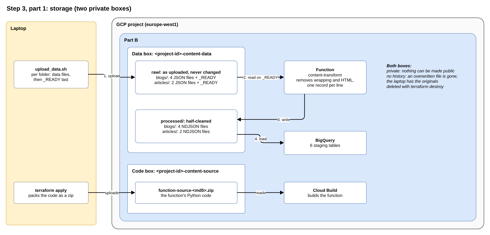

# Step 3, part 1: storage

**Planning file:** [03_resource-inventory.md](../v2_architecture/03_resource-inventory.md) (storage), with D1.4, D1.7, D1.9, D1.12, D2.5 and D2.6 from the [brainstorming](../v1_brainstorming/README.md)

**Status:** closed

**Built in:** phase 2

**Review:** how this step fits the story and the Data Engineering aim is at the end of this file ([Review](#review)).

 

## In plain words

**In one sentence:** two private storage boxes: one for the data, one for the function's code.

**The data box** has two shelves:

- **`raw/`:** the files exactly as the maintainer uploads them from the laptop. Nothing ever changes them.
- **`processed/`:** the same data after the function has worked on it, one file per raw file. BigQuery loads its tables from here.

The `processed/` files are already partly cleaned; the plan calls them "half-cleaned". The function does three things to each raw file:

| Change                 | Raw file (`raw/`)                                              | Processed file (`processed/`)                  |
| ---------------------- | -------------------------------------------------------------- | ---------------------------------------------- |
| **Wrapping removed**   | In `members`, `articles` and `article_categories`, the records sit inside an API wrapper (an "envelope": `_items` or `items`, plus paging details) | Only the records remain |
| **HTML removed**       | Article texts contain HTML tags such as `
` and `<strong>`   | Plain text (articles only)                     |
| **One record per line** | Each file is one JSON document (`.json`)                       | NDJSON: one record per line (`.ndjson`), the format BigQuery loads |

Everything else (joining categories and tags, renaming columns) happens later in BigQuery, with SQL.

Each shelf has two folders, `blogs/` and `articles/`. When all files of a folder are uploaded, the upload script adds one last, empty file called `_READY`. It means "this folder is complete, start working".

**The code box** holds the function's Python code, packed as a zip file. Terraform puts it there; Google Cloud reads it to build the function.

**Both boxes:**

- **Are private:** nothing in them can ever be made public.
- **Keep no history:** an overwritten or deleted file is gone. The laptop holds the original data, so nothing is lost.
- **Disappear with `terraform destroy`:** together with everything inside them.

 

## Technical details

 

### What this step decides

| ID    | Decision                                                                       |
| ----- | ------------------------------------------------------------------------------ |
| D1.7  | One data bucket with prefixes (`raw/`, `processed/`)                           |
| D1.12 | Function code in a separate source bucket                                      |
| D1.4  | `terraform destroy` removes the buckets with their contents (`force_destroy`)  |
| S3.1  | Both buckets: uniform bucket-level access, public access prevention enforced   |
| S3.2  | No object versioning, no soft delete                                           |
| S3.5  | Two separate resource blocks, not `for_each`: the buckets have different purposes |

 

### How it fits the story

- **Part B owns both buckets:** only the pipeline uses them (S1.1).
- **Names contain the project ID and `content`:** bucket names are unique across all of GCP, and the project is shared with other teams.

 

### Fit with the Data Engineering aim

- **Raw files stay unchanged:** the classic landing zone. To reprocess, upload the `_READY` marker again; the raw files are already there.
- **Processed files stay too:** BigQuery can be reloaded without running Python again.
- **One name through all layers (D2.5):** `raw/blogs/blog_posts.json`, then `processed/blogs/blog_posts.ndjson`, then the staging table `blog_posts`.

 

### Where each data stage lives

| Stage     | Where                        | Part     |
| --------- | ---------------------------- | -------- |
| Raw       | Data bucket, `raw/`          | 1 (this) |
| Processed | Data bucket, `processed/`    | 1 (this) |
| Staging   | BigQuery `content_staging`   | 3        |
| Cleaned   | BigQuery `content_cleaned`   | 3        |
| Analysis  | BigQuery `content_analysis`  | 3        |

Source: the data glossary in the [brainstorming README](../v1_brainstorming/README.md).

 

### Decision

| ID  | Decision | Why |
| --- | -------- | --- |
| G   | **2 buckets, for least privilege and separate lifecycles.** The build account reads only code buckets (step 4, M2); the runtime account, which can write, reaches only the data bucket. Data is uploaded and replaced; code changes only on deploy. | The plan's earlier reason ("a zip in the data bucket would fire the trigger on every deploy") is weak: the function ignores every file except `_READY`. |

 

### Final implementation

#### `storage.tf` (module)

Two `google_storage_bucket` resources, `data` and `source`, with the same settings:

| Argument                      | Value                                         | Why                                                   |
| ----------------------------- | --------------------------------------------- | ----------------------------------------------------- |
| `name`                        | `<project-id>-content-data` / `<project-id>-content-source` | Unique across GCP; `content` prefix (S2.2) |
| `project`                     | `var.project_id`                              | Explicit (S2.7)                                       |
| `location`                    | `var.region`                                  | Same region as BigQuery and the trigger (D3.2)        |
| `force_destroy`               | `true`                                        | `destroy` deletes the bucket even when it holds files (D1.4) |
| `uniform_bucket_level_access` | `true`                                        | Access by IAM only; per-file permissions switched off |
| `public_access_prevention`    | `"enforced"`                                  | No file can ever be made public                       |
| `soft_delete_policy`          | `retention_duration_seconds = 0`              | Deleted files are not kept (and billed) for 7 days    |
| `labels`                      | `local.labels`                                | `feature`, `managed_by` (S2.3)                        |

- **Versioning:** not set; it is off by default.
- **Storage class:** not set; the default `STANDARD` fits data that is read soon after upload.

#### Data bucket layout

Created by the upload script and the function, not by Terraform.

| Path                                 | Files                                                                    | Written by     |
| ------------------------------------ | ------------------------------------------------------------------------ | -------------- |
| `raw/blogs/`                         | `blog_posts.json`, `blog_categories.json`, `blog_tags.json`, `members.json`, then `_READY` | Upload script |
| `raw/articles/`                      | `articles.json`, `article_categories.json`, then `_READY`                | Upload script  |
| `processed/blogs/`                   | The 4 blog files as `.ndjson`                                            | Function       |
| `processed/articles/`                | The 2 article files as `.ndjson`                                         | Function       |

- **Events per upload:** 14 (6 raw files, 2 markers, 6 processed files). Only the 2 markers start real work; the rest end at once.
- **Why not filter the events:** a Cloud Storage trigger filters by bucket only, not by folder.

#### Source bucket content

One zip file per code version: `function-source-<md5 of zip>.zip` (part 2, the function).

#### Done when (phase 2)

- Both buckets exist: `gcloud storage buckets list --project=<project-id>`.
- `terraform destroy` removes them; `terraform apply` creates them again (S8.4).

 

## Review

**Fits the story:** yes. Only the pipeline uses these boxes, so they belong to Part B. Their names contain the project ID and `content`, so they cannot clash with anyone else's.

**Fits the Data Engineering aim:** yes, well.

- **Landing zone:** keeping the raw files untouched is a classic Data Engineering pattern. To reprocess, upload `_READY` again.
- **Reload without Python:** the processed files stay too, so BigQuery can be reloaded without running Python again.
- **One name through every layer:** `blog_posts.json`, then `blog_posts.ndjson`, then the table `blog_posts`.

**Correction G (decided; reason confirmed by M2 in step 4):** the design is right, but its reason was weak. The plan said the code zip needs its own box because otherwise "every deploy would wake the function". That is not a real problem: the function ignores every file except `_READY` and stops at once. The real reasons:

- **The worker cannot touch the code:** the account that runs the function can **write**, and it reaches only the data box.
- **Code and data have different lives:** the data is uploaded and replaced; the code changes only on deploy.
- **The builder reads only code:** a condition on its badge limits it to code boxes (step 4, M2), so it cannot read the data.
