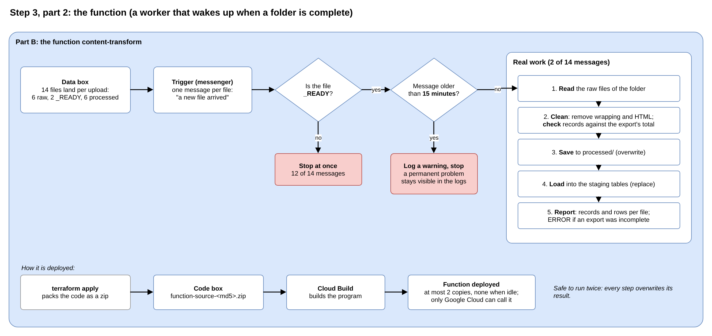

# Step 3, part 2: the function

**Planning file:** [03_resource-inventory.md](../v2_architecture/03_resource-inventory.md) (function code, function), with D1.5 to D1.11 and D2.1 to D2.5 from the [brainstorming](../v1_brainstorming/README.md)

**Status:** closed

**Built in:** phase 3 (Python, locally), phase 5 (cloud)

**Review:** how this step fits the story and the Data Engineering aim is at the end of this file ([Review](#review)).

 

## In plain words

**In one sentence:** a small Python worker that wakes up when a folder is complete, cleans its files and loads them into BigQuery.

**How it wakes up:** every file that lands in the data box sends a message: "a new file arrived". Each message wakes the function. The function looks at the file name:

- **Not `_READY`:** "not my signal", and it stops at once.
- **`_READY`:** "this folder is complete", and it starts working.

One upload of both folders sends 14 messages, one per file that lands in the data box:

| #     | File that lands                          | Put there by     | Messages | Function does   |
| ----- | ---------------------------------------- | ---------------- | -------- | --------------- |
| 1-4   | The 4 blog files in `raw/blogs/`         | Upload script    | 4        | Stops at once   |
| 5     | `raw/blogs/_READY`                       | Upload script    | 1        | **Real work**   |
| 6-7   | The 2 article files in `raw/articles/`   | Upload script    | 2        | Stops at once   |
| 8     | `raw/articles/_READY`                    | Upload script    | 1        | **Real work**   |
| 9-14  | The 6 cleaned files in `processed/`      | The function     | 6        | Stops at once   |

The last 6 come from the function itself: saving its own results is also "a new file arrived". The trigger cannot listen to one folder only; it hears the whole data box.

**What it does with a complete folder:**

1. **Reads** each raw file of the folder (`raw/blogs/` or `raw/articles/`).
2. **Cleans** it: removes the wrapping, removes the HTML from article texts, writes one record per line. Where the export states its own total, it **checks** that the number of records matches it.
3. **Saves** the result on the `processed/` shelf.
4. **Loads** each processed file into its staging table in BigQuery, replacing the old content.
5. **Writes a short report** to the logs: how many records it wrote and how many rows BigQuery loaded.

**Safe to run twice:** every step overwrites its result. If the same message arrives twice, the outcome is the same.

**How Terraform deploys it:** Terraform packs the Python code into a zip, puts the zip in the code box, and tells Google Cloud to build and run the function from it. When the code changes, the zip gets a new name, and Terraform deploys the new version.

**Small and cheap:** at most 2 copies run at the same time, and none runs when no files arrive. Only Google Cloud itself can call it; nothing on the internet can.

 

## Technical details

 

### What this step decides

| ID    | Decision                                                                                |
| ----- | --------------------------------------------------------------------------------------- |
| D1.5  | Processing is event-driven: a file landing in the bucket starts it                      |
| D1.8  | A Cloud Run function (Google builds the container; no Dockerfile)                       |
| D1.9  | A `_READY` marker, uploaded last, signals a complete group                              |
| D1.10 | Every step overwrites its output; loads use `WRITE_TRUNCATE`                            |
| D1.11 | Terraform zips, uploads and deploys the code                                            |
| D2.1  | The function writes NDJSON to `processed/`; BigQuery loads from those files             |
| D2.2  | Python only unwraps and cleans HTML; all joins are SQL                                  |
| D2.3  | The function starts the load jobs itself                                                |
| S3.3  | At most 2 instances, minimum 0, internal ingress only                                   |
| S3.9  | Terraform passes `PROJECT_ID`, `STAGING_DATASET`, `BQ_LOCATION` as environment variables |

 

### How it fits the story

- **Part B owns the function:** only the pipeline uses it.
- **Its container image** goes to `gcf-artifacts`, a repository Google creates on the first deploy (S1.6). Neither team manages it.

 

### Fit with the Data Engineering aim

- **Event-driven batch:** a file arrival starts the work; no schedule, no manual step.
- **Completeness signal:** the `_READY` marker solves "one event per file, but the joins need the whole group".
- **Idempotent:** overwrite plus `WRITE_TRUNCATE`; a duplicate event gives the same result. Eventarc delivers events at least once, so this is required, not optional.
- **ELT:** Python only reshapes; BigQuery does the modelling.
- **Batch load, not streaming:** loading from Cloud Storage is free; streaming inserts are billed.

 

### Refinements

H and I: accepted. I was revised after the external review of the plan: the check now compares with the export's own total.

| ID  | Finding | Proposal |
| --- | ------- | -------- |
| H   | **A permanent failure is retried for days.** The trigger retries failed events (`RETRY_POLICY_RETRY`), which the plan needs: with at most 2 instances, some events are rejected and must come back. But a permanent error is retried too. Example: a field the strict staging schema does not know makes the load fail on every attempt. Google's default retry window is 7 days, and every retry runs the whole group again. Google's retry guide recommends an end condition: ignore events older than a set age. | Ignore events older than 15 minutes: log a warning and stop. A temporary problem is solved by a retry within 15 minutes; a permanent one stops after 15 minutes and stays visible in the logs. |
| I   | **The pipeline does not check that an export is complete.** The plan only logs the record and row counts. Comparing records written with rows loaded would mostly test the code against itself: with strict loading, BigQuery either loads every row or fails. The exports carry their own totals (`_totalCount` in `members`, `totalCount` in `articles` and `article_categories`), and `members` was exported with `_limit: 50`, so a cut-off export is a real risk. | Compare the number of records in each wrapped export with its own total, and log an `ERROR` when they differ. The 3 blog files are plain lists without a total; the row counts in `data_checks.sql` cover them. Log one JSON line per file with a `severity` field, so Cloud Logging can filter on it. |

 

### Final implementation

#### `function.tf` (module): the code package

| Piece                 | Terraform                                | Settings                                                          |
| --------------------- | ---------------------------------------- | ----------------------------------------------------------------- |
| Zip                   | `data "archive_file" "function"`          | `type = "zip"`; `source_dir = "${path.module}/function"`; `output_path = "${path.root}/.build/content-function.zip"` (git-ignored, S6.5); `excludes = ["__pycache__"]` |
| Zip upload            | `google_storage_bucket_object`           | `name = "function-source-${data.archive_file.function.output_md5}.zip"`; `bucket` = source bucket; `source` = the zip |

- **Hash in the name:** a code change gives a new name, so Terraform sees a change and redeploys.

#### `function.tf` (module): the function

`google_cloudfunctions2_function`, named `content-transform`, `location = var.region`, `labels = local.labels`.

| Block            | Argument                  | Value                                                    |
| ---------------- | ------------------------- | -------------------------------------------------------- |
| `build_config`   | `runtime`                 | The newest Python runtime supported at implementation    |
|                  | `entry_point`             | `handle_event`                                           |
|                  | `source.storage_source`   | Source bucket and the zip's object name                  |
|                  | `service_account`         | `content-build`                                          |
| `service_config` | `max_instance_count`      | `2`                                                      |
|                  | `min_instance_count`      | `0`                                                      |
|                  | `available_memory`        | `"256M"`                                                 |
|                  | `timeout_seconds`         | `300` (it waits for the load jobs to finish)             |
|                  | `ingress_settings`        | `"ALLOW_INTERNAL_ONLY"`                                  |
|                  | `service_account_email`   | `content-runtime`                                        |
|                  | `environment_variables`   | `PROJECT_ID`, `STAGING_DATASET` (`content_staging`), `BQ_LOCATION` (`var.region`) |
| `event_trigger`  | `event_type`              | `"google.cloud.storage.object.v1.finalized"` (a file finished uploading) |
|                  | `event_filters`           | `attribute = "bucket"`, `value` = data bucket name       |
|                  | `trigger_region`          | `var.region`                                             |
|                  | `retry_policy`            | `"RETRY_POLICY_RETRY"`                                   |
|                  | `service_account_email`   | `content-trigger`                                        |

- **`depends_on`:** the build account's 3 grants and the trigger account's `eventReceiver` grant (S5.2). The function uses them without referencing them, so Terraform cannot see the dependency.

#### `function/main.py`: what the code does

| #   | Step                     | Detail                                                                                 |
| --- | ------------------------ | -------------------------------------------------------------------------------------- |
| 1   | Check the event          | Object name not ending in `/_READY`: return. Event older than 15 minutes (H): log a warning, return |
| 2   | Find the group           | The folder name: `raw/blogs/_READY` gives `blogs`                                      |
| 3   | For each file of the group | Read `raw/<group>/<file>.json`                                                       |
| 4   | Unwrap and check         | `_items` or `items` envelope: take the list; plain list: keep it. Envelope with a total: compare it with the number of records; `ERROR` if they differ (I) |
| 5   | Clean HTML               | Articles only: `articleText` to plain text                                             |
| 6   | Write NDJSON             | `processed/<group>/<file>.ndjson`, one record per line, overwriting                    |
| 7   | Load                     | Load job into `content_staging.<file>`: NDJSON, `WRITE_TRUNCATE`, the table's own schema, no bad records allowed, no unknown fields allowed (D3.9) |
| 8   | Report                   | One JSON log line per file: records written, rows loaded                               |

**The source total check (I):**

| File                 | Total field   | Other envelope fields                       |
| -------------------- | ------------- | ------------------------------------------- |
| `members`            | `_totalCount` | `_limit: 50`, `_offset`, `_tooManyToCount`  |
| `articles`           | `totalCount`  | `length`, `totalPages`                      |
| `article_categories` | `totalCount`  | `length`, `totalPages`                      |
| 3 blog files         | None          | Plain lists; no envelope                    |

- **On a mismatch:** log an `ERROR` naming the file, the records found and the total stated; the group is still loaded. Stopping would only trigger retries (H) that cannot fix the source.
- **Pure function:** part of the unwrap step, tested with pytest in phase 3, including a test with a cut-off export.

**Groups (fixed in the code):**

| Group      | Files                                                              |
| ---------- | ------------------------------------------------------------------ |
| `blogs`    | `blog_posts`, `blog_categories`, `blog_tags`, `members`            |
| `articles` | `articles`, `article_categories`                                   |

- **Pure functions** for steps 4 to 6 (no cloud calls), tested with pytest against `data/dummy/` in phase 3.
- **Settings** read from the environment variables; no name written in the code twice.

#### `function/requirements.txt`

| Package                  | For                                    |
| ------------------------ | -------------------------------------- |
| `functions-framework`    | Receiving the event                    |
| `google-cloud-storage`   | Reading and writing files              |
| `google-cloud-bigquery`  | Starting load jobs                     |
| `beautifulsoup4`         | Turning HTML into plain text           |

Versions pinned at implementation.

#### Done when

- **Phase 3:** pytest passes, including a test with a cut-off export (I); 6 NDJSON files written locally, with the same record count as their source files.
- **Phase 5:** after an upload, the logs show 2 working runs; `processed/` holds 6 files; a second upload gives the same counts.

 

### New in this review

Not in the plan before; proposed here:

- **Refinements H and I.**
- **Entry point name:** `handle_event`.
- **HTML library:** `beautifulsoup4` (the plan says only that regular expressions are not enough).
- **Group file lists fixed in the code:** a missing file then gives a clear error instead of a silently smaller group.

 

## Review

**Fits the story:** yes. Only the pipeline uses the function, so it belongs to Part B.

**Fits the Data Engineering aim:** this is the strongest part of the plan. It shows:

- **Event-driven processing:** a file arrival starts the work; no schedule, no manual step.
- **A completeness signal:** the `_READY` marker.
- **Idempotency:** running the same work twice gives the same result.
- **The Python and SQL split (ELT):** Python only cleans; SQL does the rest.

**H. A permanent failure would be retried for 7 days (accepted).** When the function fails, Google sends the message again. The plan needs this: when 2 copies are busy, extra messages are turned away and must come back later. But some failures never go away. For example, a file with a field the staging table does not know fails the load every time. Google keeps retrying for up to 7 days, and each attempt redoes the whole folder.
→ The function ignores messages older than 15 minutes. A temporary problem is solved by a retry within 15 minutes; a permanent one stops and stays visible in the logs. Google's retry guide recommends this pattern.

**I. Is the export complete? (accepted; revised after the external review)** The plan only logs the counts. Comparing "records written" with "rows loaded" would mostly test our own code: with strict loading, BigQuery loads every row or fails.
→ The exports state their own total: `members` says how many members exist (`_totalCount`), and the articles files say it too (`totalCount`). The function compares the records it finds with that total and logs an error if they differ. `members` was exported with a limit of 50 per page, so a cut-off export is a real risk. This tests the **data**, not the code: a classic Data Engineering check.
