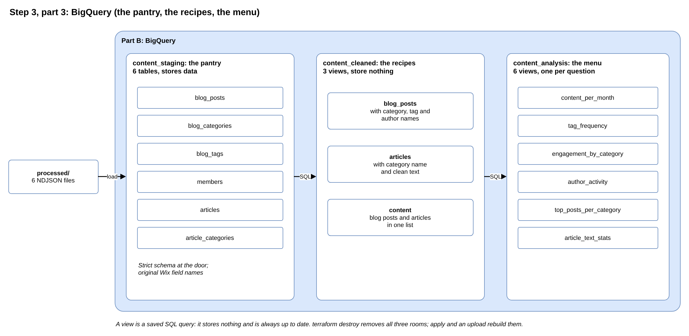

# Step 3, part 3: BigQuery

**Planning file:** [03_resource-inventory.md](../v2_architecture/03_resource-inventory.md) (BigQuery), with D2.4 and D3.1 to D3.14 from the [brainstorming](../v1_brainstorming/README.md)

**Status:** closed

**Built in:** phase 4 (datasets, staging tables), phase 6 (cleaned views), phase 7 (analysis views)

**Review:** how this step fits the story and the Data Engineering aim is at the end of this file ([Review](#review)).

 

## In plain words

**In one sentence:** the warehouse: one room stores the data as delivered, one room prepares it, one room answers the questions.

BigQuery has three rooms (datasets). They work like a kitchen:

| Room (dataset)       | Kitchen        | Holds                                      | Stores data? |
| -------------------- | -------------- | ------------------------------------------ | ------------ |
| `content_staging`    | The pantry     | 6 tables: the data exactly as delivered     | **Yes**      |
| `content_cleaned`    | The recipes    | 3 views: the data prepared and combined     | No           |
| `content_analysis`   | The menu       | 6 views: one answer per question            | No           |

**The pantry (staging):** the only room that stores data. The function loads each processed file into its own table: 6 files, 6 tables. Each table has a fixed list of columns and types (its **schema**), like a strict door list. A file with an unknown field or a wrong type is turned away, and the load fails at once. The tables keep the original Wix field names (`firstPublishedDate`).

**The recipes (cleaned):** a **view** is a saved SQL query. It stores nothing; each time someone reads it, it runs on the pantry's data, so it is always up to date. The cleaned views:

- **`blog_posts`:** each post with its category names, tag names and author name filled in, column names tidied (`first_published_date`).
- **`articles`:** each article with its category name and its clean text.
- **`content`:** blog posts and articles together in one list, with the same columns for both.

**The menu (analysis):** 6 views, each answering one question about the content (listed below).

**On `terraform destroy`:** all three rooms disappear with everything in them. The laptop holds the original data, so a new `apply` and upload rebuild everything.

 

## Technical details

 

### What this step decides

| ID    | Decision                                                                           |
| ----- | ---------------------------------------------------------------------------------- |
| D3.1  | One dataset per layer: `content_staging`, `content_cleaned`, `content_analysis`    |
| D3.2  | Datasets and the data bucket share one region                                      |
| D3.3  | Staging tables are 1:1 copies of the processed files; Wix field names and nesting kept |
| D3.4  | Schemas live in JSON files, read by Terraform                                      |
| D3.5  | Cleaned views keep categories and tags as nested lists inside each post            |
| D3.6  | Cleaned views rename columns to snake_case                                         |
| D3.7  | No partitioning or clustering                                                      |
| D3.9  | Strict staging: an unknown field or a wrong type fails the load                    |
| D3.10 | Always-empty arrays stay in the schema as `REPEATED STRING`                        |
| D3.11 | One `content` view for both content types, with `categories` and `tags` as lists   |
| D3.13 | Analysis queries are views in their own dataset                                    |
| D3.14 | All view SQL lives in `.sql` files, read with `templatefile()`                     |
| S3.4  | `for_each` for datasets, staging tables and views                                  |
| S3.6  | One view block per layer; `content` has its own block                              |
| S3.7  | Each view block waits for the layer it reads (`depends_on`)                        |
| S3.10 | A sixth analysis view, `article_text_stats`, shows the result of the HTML cleaning |
| S3.11 | Each analysis SQL file starts with its metric definition                           |

 

### Refinements

J, K and L: accepted. The 6 questions in J are a draft; their wording is refined in phase 7.

| ID  | Finding | Proposal |
| --- | ------- | -------- |
| J   | **The analysis views are described by SQL technique, not by question.** The plan lists them as "window function", "`UNNEST`" and so on. A reader of the results wants to know what each view answers. | Each analysis SQL file opens with the **question** it answers, then the metric definition (S3.11). The questions are in the table below. |
| K   | **The views' `deletion_protection` is missing in step 3.** In the `google` provider, every `google_bigquery_table` has `deletion_protection = true` by default, and a view is a `google_bigquery_table`. The step 3 inventory sets `false` only on the staging tables; step 5 (S5.6) already says "tables and views". The two plan files disagree. | Set `deletion_protection = false` on all 15 table resources: 6 staging tables and 9 views. The final implementation follows step 5. |
| L   | **"Why not Dataform or dbt?" is not answered.** These tools are the usual home for SQL layers on GCP, and a reviewer will ask. | Record the reason: 9 views with no stored results need no extra tool; Terraform already creates them. Dataform pays off once there are tables rebuilt on a schedule, incremental loads or built-in tests. |

 

### Final implementation

#### `bigquery.tf` (module): datasets

`google_bigquery_dataset`, `for_each` over the 3 layers.

| Argument                     | Value                                                    |
| ---------------------------- | -------------------------------------------------------- |
| `dataset_id`                 | `content_${each.key}`: `content_staging`, `content_cleaned`, `content_analysis` |
| `project`                    | `var.project_id`                                         |
| `location`                   | `var.region` (same as the bucket, D3.2)                  |
| `description`                | One sentence per layer                                   |
| `delete_contents_on_destroy` | `true` (D1.4)                                            |
| `labels`                     | `local.labels` plus `layer = each.key`                   |

#### `bigquery.tf` (module): staging tables

`google_bigquery_table`, `for_each` over the 6 table names, in `content_staging`.

| Argument              | Value                                                  |
| --------------------- | ------------------------------------------------------ |
| `table_id`            | `blog_posts`, `blog_categories`, `blog_tags`, `members`, `articles`, `article_categories` |
| `schema`              | `file("${path.module}/schemas/${each.key}.json")`       |
| `deletion_protection` | `false`                                                |
| `labels`              | `local.labels`                                         |

#### `schemas/*.json`: one file per staging table

| Rule                          | Detail                                                                    |
| ----------------------------- | ------------------------------------------------------------------------- |
| Column names                  | Exactly as in the Wix exports (`firstPublishedDate`, `categoryIds`)        |
| `mode` on every column        | `REQUIRED` for `_id`; `NULLABLE` for single values; `REPEATED` for arrays. Without an explicit mode, BigQuery fills one in, and Terraform reports a change on every `plan` |
| Dates                         | `TIMESTAMP` (the exports use ISO 8601 strings)                             |
| Nested objects                | `RECORD` with their own `fields` (`metrics`, `media`, `profile`)          |
| Always-empty arrays (D3.10)   | `REPEATED STRING`: `internalCategoryIds`, `internalRelatedPostIds`, `pricingPlanIds`, `relatedPostIds`, `translations` |

#### `bigquery.tf` (module): views

All views: `google_bigquery_table` with a `view` block (`query = templatefile(...)`, `use_legacy_sql = false`), `deletion_protection = false` (K).

| Block      | Dataset            | Views                                   | `depends_on`                         |
| ---------- | ------------------ | --------------------------------------- | ------------------------------------ |
| `cleaned`  | `content_cleaned`  | `blog_posts`, `articles` (`for_each`)   | Staging tables                       |
| `content`  | `content_cleaned`  | `content`                               | `cleaned` views                      |
| `analysis` | `content_analysis` | The 6 views below (`for_each`)          | `cleaned` views and `content` view   |

- **Why `depends_on`:** BigQuery checks a view's SQL when the view is created, so every table it reads must already exist. Terraform cannot see table names inside SQL text.
- **Placeholders in the SQL:** `${project}`, `${staging_dataset}`, `${cleaned_dataset}`. Table names are written directly, so the files read like normal SQL.

#### `sql/cleaned/`: cleaned views

| View         | One row per | Columns                                                                                     |
| ------------ | ----------- | ------------------------------------------------------------------------------------------- |
| `blog_posts` | Blog post   | `id`, `title`, `slug`, `excerpt`, `first_published_date`, `last_published_date`, `minutes_to_read`, `author_nickname`, `views`, `likes`, `categories` (list of `id`, `title`), `tags` (list of `id`, `label`) |
| `articles`   | Article     | `id`, `title`, `lead`, `created_date`, `category_title`, `keywords` (list), `article_text`  |
| `content`    | Post or article | `content_type` (`blog_post` or `article`), `content_id`, `title`, `published_at`, `categories` (list of names), `tags` (list of names) |

- **Posts without tags stay in:** `LEFT JOIN UNNEST(...)`, not `CROSS JOIN UNNEST(...)`, which would drop them. The full dataset has 2 such posts.
- **`content`:** articles have no publish date, so `published_at` is `_createdDate`; their single category becomes a list of one; their `keywords` serve as tags.

#### `sql/analysis/`: analysis views (J)

The questions are a draft: decided now, so the cleaned views contain the columns they need (for example `views`); the wording is refined in phase 7, when the SQL is written.

**Chosen from the data** (the dummy data keeps the full dataset's IDs, dates and metrics):

- **Comments and ratings are 0 on every post:** engagement uses views and likes only.
- **Authors get an answer:** `members` filled only the `author_nickname` column of the cleaned view; no analysis view used it. `author_activity` does.
- **The running total is a column of `content_per_month`:** it was only a running sum of the same numbers.
- **Not used:** `minutesToRead` (2 on almost every post), `featured` and `pinned` (never set).

| View                     | Question it answers                                                         | SQL technique                         |
| ------------------------ | --------------------------------------------------------------------------- | ------------------------------------- |
| `content_per_month`      | How much content was published each month, per content type, and what is the running total? | `GROUP BY` month, `SUM() OVER (ORDER BY month)` |
| `tag_frequency`          | Which tags and keywords are used most, per month and content type?          | `UNNEST(tags)`                        |
| `engagement_by_category` | Which blog categories get the most views and likes per post?                | `UNNEST(categories)`, `metrics`       |
| `author_activity`        | Which authors publish the most posts, and how many views do their posts get on average? | `GROUP BY author_nickname` (the name comes from `members`, joined in the cleaned view) |
| `top_posts_per_category` | Which 3 posts have the most views in each category?                         | `ROW_NUMBER() OVER (PARTITION BY ...)`|
| `article_text_stats`     | How long are the articles, and how long do they take to read, per category? | `SPLIT`, `ARRAY_LENGTH`, `AVG() OVER` |

Each SQL file opens with a comment: the question, then the metric definition (for example, "reading time = words / 200, rounded up").

#### Not built

- **Partitioning and clustering (D3.7):** queries on this data size cost the minimum anyway, and views cannot be partitioned.

#### Done when

- **Phase 4:** a manual `bq load` of each local NDJSON file succeeds with strict settings; row counts match the source files.
- **Phase 6:** each cleaned view has one row per post or article; `content` has their sum; no category or tag name is empty.
- **Phase 7:** each analysis view returns rows; one number is checked by hand.

 

### New in this review

Not in the plan before; proposed here:

- **Refinements J, K and L.**
- **Cleaned view columns** (the plan named only a few).
- **Top 3** posts per category; **200 words per minute** reading speed.
- **The 6 analysis views:** `author_activity` replaces `content_running_total`, whose running total moves into `content_per_month`; `engagement_by_category` drops comments.
- **`id` as the column name** for `_id` in the cleaned views.

 

## Review

**Fits the story:** yes. Only the pipeline uses these datasets, so they belong to Part B. The `content_` prefix keeps them apart from other teams' datasets in the shared project.

**Fits the Data Engineering aim:** this is where most of the Data Engineering skill shows:

- **Layers:** staging, cleaned and analysis, the medallion pattern (bronze, silver, gold).
- **A strict schema at the door:** bad data fails loudly instead of slipping in.
- **BigQuery-style modelling:** categories and tags as nested lists inside each post, instead of extra join tables.
- **SQL skills:** `UNION ALL`, `UNNEST`, window functions.
- **Right-sizing:** views instead of stored tables, and no partitioning, each with a reason.

**J. Questions, not techniques (accepted; the questions are a draft).** The plan lists the analysis views by SQL technique ("window function"). A reader wants to know what each view answers.
→ Each SQL file opens with its question, for example "Which 3 posts have the most views in each category?".

**K. The views' safety lock (accepted).** Terraform protects every BigQuery table from deletion by default, and to Terraform a view is also a table. The step 3 plan file switches the protection off only for the 6 staging tables; the step 5 plan file says "tables and views". The plan is right overall, but its two files disagree.
→ Switch it off for all 15 (6 tables and 9 views), as step 5 says.

**L. "Why not Dataform or dbt?" (accepted).** These are the usual tools for SQL layers, and a reviewer will ask.
→ Write down the answer: 9 views that store nothing need no extra tool. Dataform pays off once tables are rebuilt on a schedule.
