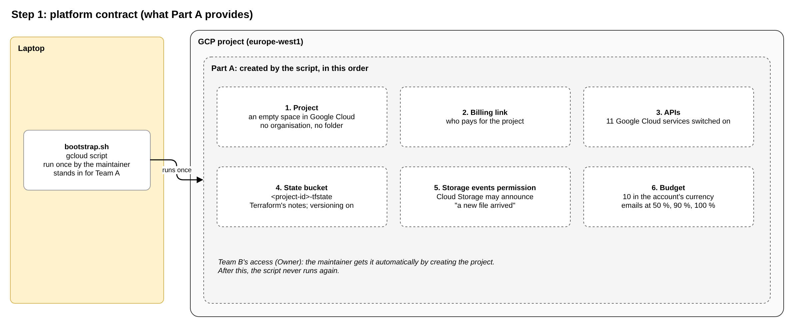

# Step 1: platform contract

**Planning file:** [01_platform-contract.md](../architecture/01_platform-contract.md)

**Status:** closed

**Built in:** phase 1

**Review:** how this step fits the story and the Data Engineering aim is at the end of this file ([Review](#review)).

 

## In plain words

**In one sentence:** prepare an empty, paid-for project with the services switched on, a place for Terraform's notes and a cost alarm.

Before Team B can build anything, someone has to prepare the place where it will live. In the story, Team A did this. In practice, the maintainer runs one script once, `bootstrap.sh`, which plays Team A's role. It does 6 things:

1. **Creates the project:** an empty space in Google Cloud, like a new empty folder.
2. **Connects billing:** links the project to the payment account, so Google Cloud services can run.
3. **Switches on the services:** in a new project, every Google Cloud service (storage, BigQuery, functions) is switched off. The script switches on the 11 the pipeline needs.
4. **Creates a storage box for Terraform's notes:** Terraform keeps notes about what it has built. Those notes need a safe place: the state bucket.
5. **Gives Cloud Storage one permission:** when a file is uploaded, Cloud Storage must be allowed to announce "a new file arrived", so the function wakes up.
6. **Sets a budget alarm:** if spending approaches 10 (in the billing account's currency), an email arrives.

The maintainer becomes the project's `Owner` automatically by creating it. After this, the ground is ready, and the script never runs again.

 

## Technical details

 

### What this step decides

Team A runs the shared GCP project. Team B (the maintainer) adds the content pipeline. Before writing any code, Team B needs to know: **what already exists, and what must we build ourselves?**

Step 1 is the answer: a contract between the two teams.

- **Part A** (Team A) provides 6 things.
- **Part B** (Team B) builds everything else.
- **The rule:** "Would a second feature need this too?" Yes: Part A. No: Part B.
- **Part B does not change Part A's code or remove anything from it.** It adds a few permissions to the project, such as the right to start BigQuery jobs.

The full story is in [step-0_story-overview.md](step-0_story-overview.md).

 

### What Part A provides

| #   | Element                                       | In plain words                                        |
| --- | --------------------------------------------- | ----------------------------------------------------- |
| 1   | Project, billing, region `europe-west1`       | The place where everything lives, and who pays for it |
| 2   | Team B's access: `Owner`                      | Team B may create anything in the project             |
| 3   | Budget with email alerts                      | An email warns before costs grow                      |
| 4   | Terraform state bucket                        | Where Terraform keeps its records                     |
| 5   | APIs enabled                                  | The GCP services are switched on                      |
| 6   | Cloud Storage's permission to publish events  | Cloud Storage can announce "a new file arrived"       |

 

### Decisions

| Topic           | Decision                                                            |
| --------------- | ------------------------------------------------------------------- |
| Story           | Team A built Part A with Terraform; the maintainer is Team B only   |
| Team B's access | `Owner` (simplest)                                                  |
| Stand-in        | `bootstrap/bootstrap.sh` creates Part A for the demo                |
| Module wording  | "Standalone, deployed once per project", not "reusable" (step 2)    |

 

### Final implementation: `bootstrap/bootstrap.sh`

A `gcloud` script that creates Part A once. The maintainer runs it with their own login; Claude only writes it.

#### Inputs

Read from environment variables, so no private value is committed.

| Variable          | Example                | Required                          |
| ----------------- | ---------------------- | --------------------------------- |
| `PROJECT_ID`      | `content-demo-123456`  | Yes                               |
| `BILLING_ACCOUNT` | `0X0X0X-0X0X0X-0X0X0X` | Yes                               |
| `REGION`          | `europe-west1`         | No; default `europe-west1`        |
| `BUDGET_AMOUNT`   | `10`                   | No; default `10` (billing account's currency) |

#### Steps, in order

| #   | Creates                        | Command                                                                                     | Settings                                                       |
| --- | ------------------------------ | ------------------------------------------------------------------------------------------- | -------------------------------------------------------------- |
| 1   | Project                        | `gcloud projects create`                                                                    | No organisation, no folder                                     |
| 2   | Billing link                   | `gcloud billing projects link`                                                              | `BILLING_ACCOUNT`                                              |
| 3   | APIs                           | `gcloud services enable`                                                                    | The 11 APIs below                                              |
| 4   | State bucket                   | `gcloud storage buckets create`, then `gcloud storage buckets update --versioning`          | Name `<project-id>-tfstate`; `REGION`; uniform bucket-level access; public access prevention; versioning on |
| 5   | Service agent permission       | `gcloud storage service-agent` (prints the email), then `gcloud projects add-iam-policy-binding` | `roles/pubsub.publisher`                                   |
| 6   | Budget                         | `gcloud billing budgets create`                                                             | Limited to the project; `BUDGET_AMOUNT`; alerts at 50 %, 90 % and 100 % |

- **`Owner`:** not a step. The maintainer becomes `Owner` by creating the project.
- **State bucket versioning:** keeps old versions of the state file, so a damaged state can be restored. The pipeline's own buckets have no versioning.
- **Runs once:** the script is not built to run twice. If a step fails, fix the cause and run the remaining steps by hand.

#### APIs (step 3)

| API                                   | Needed for                           |
| ------------------------------------- | ------------------------------------ |
| `storage.googleapis.com`              | Buckets                              |
| `cloudfunctions.googleapis.com`       | The function                         |
| `run.googleapis.com`                  | The service that runs the function   |
| `cloudbuild.googleapis.com`           | Building the function's container    |
| `artifactregistry.googleapis.com`     | Storing the container image          |
| `eventarc.googleapis.com`             | The Cloud Storage trigger            |
| `pubsub.googleapis.com`               | Event delivery behind the trigger    |
| `bigquery.googleapis.com`             | Datasets, tables, views, load jobs   |
| `iam.googleapis.com`                  | Part B's service accounts            |
| `cloudresourcemanager.googleapis.com` | Part B's project-level role grants   |
| `billingbudgets.googleapis.com`       | The budget (step 6)                  |

#### Done when

- `gcloud services list --enabled --project=<project-id>` shows all 11 APIs.
- `gcloud storage buckets describe gs://<project-id>-tfstate` shows the bucket with versioning on.
- The budget appears in the Cloud Console under **Billing > Budgets & alerts**.

#### Check at implementation

- The exact flags of each command against the current `gcloud` documentation.
- Whether `gcloud billing budgets create` needs a quota project with a personal login.

#### New in this review

Not in the plan before; proposed here:

- **State bucket name:** `<project-id>-tfstate`.
- **Budget amount:** 10 in the billing account's currency.
- **Inputs as environment variables.**

 

## Review

**Fits the story:** this step is the story. The ownership rule is clear, and each of the 6 elements passes its test. Two decisions are especially good:

- **APIs in Part A:** if Part B switched APIs on, its `destroy` could switch them off for every other team.
- **A script as the stand-in:** it avoids a chicken-and-egg problem (see below).

**The chicken-and-egg problem:** which comes first, the chicken or the egg? Each needs the other to exist first.

- **Terraform needs a place for its notes:** before Terraform creates anything, it must know where to keep its notes (the state bucket).
- **The state bucket is one of the things Part A creates:** if Part A were built with Terraform, Terraform would need the bucket before the bucket exists.
- **The usual fix with Terraform:** keep the notes in a file on the laptop first, create the bucket, then move the notes into it (`terraform init -migrate-state`). It works, but it is an extra setup with its own notes, unrelated to the pipeline.
- **The fix here:** a `gcloud` script keeps no notes, so the problem never appears. The script creates the bucket; Part B's Terraform then uses it from its very first run.

**Fits the Data Engineering aim:** this step is mostly infrastructure, which is correct; it should stay small. Its one Data Engineering point is the region: `europe-west1` keeps the data in the EU (data residency), and the bucket, the datasets and the trigger must share one location.
