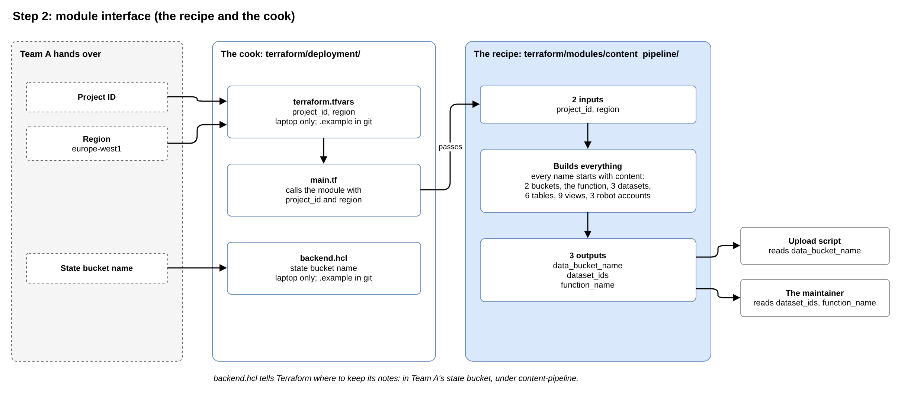

# Step 2: module interface

**Planning file:** [02_module-interface.md](../architecture/02_module-interface.md)

**Status:** closed

**Built in:** phase 2

**Review:** how this step fits the story and the Data Engineering aim is at the end of this file ([Review](#review)).

 

## In plain words

**In one sentence:** write the pipeline as a recipe that needs only a project ID and a region, plus a small folder that runs it.

The Terraform code is split into two folders, like a **recipe** and a **cook**:

- **The recipe (the module):** describes everything the pipeline needs: buckets, the function, the BigQuery datasets. It does not know which project to build in. It says: "give me a project ID and a region, and I build everything there".
- **The cook (the deployment folder):** takes the recipe and fills in the blanks: "use this project, in this region". It also tells Terraform where its notes are kept: the storage box from step 1.

**What goes in:** 2 things, the project ID and the region. Both come from step 1.

**What comes out:** 3 names, printed after Terraform finishes:

- **The bucket's name:** the upload script needs it to know where to send the files.
- **The datasets' names:** where the data lives in BigQuery.
- **The function's name:** where to look in the logs.

**Naming:** everything the recipe creates starts with `content` (for example `content_staging`). The project is shared with other teams, so this prevents name clashes.

**Privacy:** the real project ID and bucket name stay in two small files on the laptop, never uploaded to GitHub. GitHub gets example copies with placeholder values.

 

## Technical details

 

### What this step decides

A Terraform **module** works like a Python function:

| Python function  | Terraform module                                    |
| ---------------- | --------------------------------------------------- |
| Arguments        | **Inputs** (variables)                              |
| Function body    | The resources it creates                            |
| Return values    | **Outputs**                                         |
| The calling code | The **deployment folder** (`terraform/deployment/`) |

The deployment folder calls the module, passes the inputs, and tells Terraform where to keep its records (the state bucket).

 

### How it fits the story

The inputs are exactly what Team A hands over:

| Team A hands over | Enters Part B as                                  |
| ----------------- | ------------------------------------------------- |
| Project ID        | The `project_id` input                            |
| Region            | The `region` input                                |
| State bucket name | `backend.hcl`, read only by the deployment folder |

**Every name starts with `content`:** the project is shared, so another team's `staging` dataset cannot clash with `content_staging`.

 

### Decisions

| Decision                            | In plain words                                                                 |
| ----------------------------------- | ------------------------------------------------------------------------------ |
| Say "standalone", not "reusable"    | Names are fixed, so the module can run once per project. A second copy in the same project would clash, like a function that always writes `report.txt` into the same folder. |
| 2 inputs, no `labels` input         | A `labels` input would let the caller add extra labels, but nothing ever passes any. The module's own labels are enough. |
| 3 outputs                           | Only `data_bucket_name` is read by a script (the upload script). The other two are for the maintainer to see after `apply`. Rule: "output what a script or a person needs after `apply`". |

The last two are easier to see in code; they are revisited when phase 2 writes the files below.

 

### Final implementation

#### Module: `terraform/modules/content_pipeline/`

**`variables.tf`:** 2 inputs, both required (no default, so a missing value stops `plan`).

| Variable     | Type     | Description                                 |
| ------------ | -------- | ------------------------------------------- |
| `project_id` | `string` | The GCP project that Team A provides        |
| `region`     | `string` | The region for every regional resource      |

**`locals.tf`:** values computed inside the module; the caller cannot set them.

| Local      | Value                                                          |
| ---------- | -------------------------------------------------------------- |
| `feature`  | `"content"`: the prefix of every name                          |
| `labels`   | `{ feature = "content-pipeline", managed_by = "terraform" }`   |

Datasets add a third label, `layer` (`staging`, `cleaned` or `analysis`).

**Names the module creates:**

| Resource         | Name                                                     |
| ---------------- | -------------------------------------------------------- |
| Data bucket      | `<project-id>-content-data`                              |
| Source bucket    | `<project-id>-content-source`                            |
| Datasets         | `content_staging`, `content_cleaned`, `content_analysis` |
| Function         | `content-transform`                                      |
| Service accounts | `content-build`, `content-trigger`, `content-runtime`    |

**`outputs.tf`:**

| Output             | Value                                                          | Read by                |
| ------------------ | -------------------------------------------------------------- | ---------------------- |
| `data_bucket_name` | `<project-id>-content-data`                                    | The upload script      |
| `dataset_ids`      | Map: `staging`, `cleaned`, `analysis` to the dataset IDs       | The maintainer         |
| `function_name`    | `content-transform`                                            | The maintainer (logs)  |

**`versions.tf`:** minimum versions only (`>=`) for Terraform and the `google` and `archive` providers. No `provider` block, no `backend` block.

**Every resource** sets `project = var.project_id` and its `location` or `region = var.region` explicitly.

#### Deployment: `terraform/deployment/`

| File                       | Content                                                                     | Committed |
| -------------------------- | --------------------------------------------------------------------------- | --------- |
| `versions.tf`              | `backend "gcs"` with `prefix = "content-pipeline"`; providers with `~>`     | Yes       |
| `providers.tf`             | `google` provider with `project` and `region` from the variables            | Yes       |
| `variables.tf`             | `project_id` (required), `region` (default `"europe-west1"`)                | Yes       |
| `main.tf`                  | `module "content_pipeline"`: `source = "../modules/content_pipeline"`, passes `project_id` and `region` | Yes |
| `outputs.tf`               | The module's 3 outputs, passed on (`value = module.content_pipeline.<name>`) | Yes      |
| `.terraform.lock.hcl`      | Exact provider versions, written by `terraform init`                        | Yes       |
| `terraform.tfvars.example` | `project_id = "your-project-id"`                                            | Yes       |
| `backend.hcl.example`      | `bucket = "your-project-id-tfstate"`                                        | Yes       |
| `terraform.tfvars`         | The real project ID                                                         | No (git-ignored) |
| `backend.hcl`              | The real state bucket name                                                  | No (git-ignored) |

- **Why the backend values sit in a separate file:** a `backend` block cannot read variables. The bucket name is passed at `terraform init -backend-config=backend.hcl`.
- **Version numbers:** set in phase 2 from the current releases.

#### Done when (phase 2)

- `terraform output data_bucket_name` prints `<project-id>-content-data`.
- The state file exists in `gs://<project-id>-tfstate/content-pipeline/`.

 

## Review

**Fits the story:** very well. The inputs are exactly what Team A hands over:

| Team A hands over | Enters Part B as                                  |
| ----------------- | ------------------------------------------------- |
| Project ID        | The `project_id` input                            |
| Region            | The `region` input                                |
| State bucket name | `backend.hcl`, read only by the deployment folder |

The `content` prefix on every name fits too: Team A's project is shared, so another team's `staging` dataset cannot clash with `content_staging`.

**Fits the Data Engineering aim:** the three datasets `content_staging`, `content_cleaned` and `content_analysis` follow a well-known pattern, the **medallion architecture** (bronze, silver, gold). The `layer` label on each dataset lets the bill show what each layer costs.
