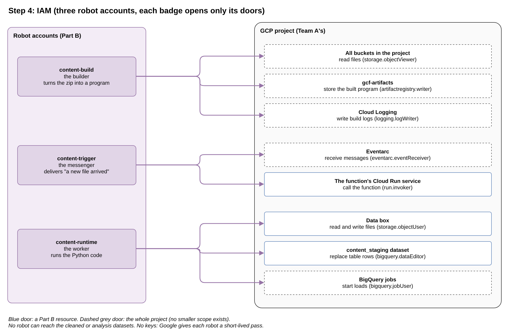

# Step 4: IAM (who may do what)

**Planning file:** [04_iam.md](../architecture/04_iam.md)

**Status:** closed

**Built in:** phase 5

**Review:** how this step fits the story and the Data Engineering aim is at the end of this file ([Review](#review)).

 

## In plain words

**In one sentence:** three robot accounts, each with an ID badge that opens only the doors its job needs.

Three jobs in the pipeline are done by machines, not by people. Each job gets its own **service account**: a robot account with its own ID badge.

| Robot account     | Its job                                        | Doors its badge opens                                                    |
| ----------------- | ---------------------------------------------- | ------------------------------------------------------------------------ |
| `content-build`   | **The builder:** turns the zip into a running program | Read the code; store the built program; write build logs          |
| `content-trigger` | **The messenger:** delivers "a new file arrived" to the function | Receive the messages; call the function                    |
| `content-runtime` | **The worker:** runs the Python code           | Read and write files in the data box; fill the staging tables; start loads in BigQuery |

**Why three robots, not one:** if one robot did everything, one stolen badge would open every door. With three, each badge opens only what its job needs. This is called **least privilege**.

**What no robot can do:** touch the cleaned or analysis rooms in BigQuery, delete datasets, or change anything of Team A.

**No keys:** a robot never gets a password file. Google gives it a short-lived pass each time it works. Nothing secret can leak from the repository.

**The maintainer:** holds `Owner` (step 1), which includes the right to create the robots and hand out their badges.

 

## Technical details

 

### What this step decides

| ID   | Decision                                                                           |
| ---- | ---------------------------------------------------------------------------------- |
| S4.1 | Three service accounts: `content-build`, `content-trigger`, `content-runtime`      |
| S4.2 | Each role at the smallest scope: bucket, dataset, service; the project only when nothing smaller exists |
| S4.3 | Only additive IAM resources (`*_iam_member`); never `*_iam_policy` or `*_iam_binding` |
| S4.4 | No service account keys                                                            |
| S4.5 | The maintainer holds `Owner` and runs Terraform with their own login               |
| S4.6 | No folder-level conditions on the data bucket                                      |

 

### Refinement

M: accepted. G's new reason (step 3.1): accepted.

| ID  | Finding | Proposal |
| --- | ------- | -------- |
| M   | **The build account's file access is probably too narrow.** The plan grants `roles/storage.objectViewer` on the source bucket only. Google's current guide for a custom build service account lists 3 roles, all granted on the **project**. It names Google's own buckets (`gcf-v2-sources-*`, `gcf-v2-uploads-*`): Google appears to copy the code there before the build. Those buckets are created by Google on the first deploy, so they cannot be targeted in advance. With the bucket-level grant, the first deploy may fail on a permission error. | Grant `roles/storage.objectViewer` on the project, as Google's guide says. The total stays 8 grants. |

**Effect on G (step 3.1):** with M, the build account can read every bucket in the project, including the data bucket. The 2 buckets stay; G's reason changes. The runtime account, which can **write**, reaches only the data bucket and cannot touch the code. Code and data also keep separate lifecycles.

 

### Final implementation: `iam.tf` (module)

#### Service accounts

`google_service_account`, 3 resources (or `for_each` over a map of 3).

| `account_id`      | `display_name`                         |
| ----------------- | -------------------------------------- |
| `content-build`   | Content pipeline: function build       |
| `content-trigger` | Content pipeline: event trigger        |
| `content-runtime` | Content pipeline: function runtime     |

#### Role grants (8)

| Account           | Role                            | Scope                           | Terraform resource                       |
| ----------------- | ------------------------------- | ------------------------------- | ---------------------------------------- |
| `content-runtime` | `roles/storage.objectUser`      | Data bucket                     | `google_storage_bucket_iam_member`       |
| `content-runtime` | `roles/bigquery.dataEditor`     | `content_staging` dataset       | `google_bigquery_dataset_iam_member`     |
| `content-runtime` | `roles/bigquery.jobUser`        | Project                         | `google_project_iam_member`              |
| `content-trigger` | `roles/run.invoker`             | The function's Cloud Run service | `google_cloud_run_v2_service_iam_member` |
| `content-trigger` | `roles/eventarc.eventReceiver`  | Project                         | `google_project_iam_member`              |
| `content-build`   | `roles/storage.objectViewer`    | **Project** (M)                 | `google_project_iam_member`              |
| `content-build`   | `roles/artifactregistry.writer` | Project                         | `google_project_iam_member`              |
| `content-build`   | `roles/logging.logWriter`       | Project                         | `google_project_iam_member`              |

- **Why each role:**
  - `objectUser`: read `raw/`, write and overwrite `processed/`.
  - `dataEditor`: replace the staging tables' rows (`WRITE_TRUNCATE`).
  - `jobUser`: start load jobs; jobs belong to a project, so no smaller scope exists.
  - `run.invoker`: call the function (a Cloud Run function runs as a Cloud Run service).
  - `eventReceiver`: receive events from Eventarc.
  - The 3 build roles: Google's guide for a custom build service account.
- **Project-level grants:** 5 (with M). They add to Team A's project; they remove nothing (S4.3).
- **The `run.invoker` grant** targets the service that the function creates, so it is created after the function (S5.5).

#### Not needed

- **A logging role for the runtime account:** Cloud Run collects whatever the code prints.
- **Bucket access for the load job:** a load job reads the files with the permissions of whoever starts it; `objectUser` covers it.
- **Access to the cleaned or analysis datasets:** the function never touches them; views run with the permissions of the person who queries them.

#### Done when (phase 5)

- The first `apply` creates the function. If it fails on a permission error, run `apply` again (S5.3): new grants can take a few minutes to take effect.
- An upload produces 6 processed files and 6 filled staging tables (the runtime account's roles work).

 

### Check at implementation

- **M:** whether the bucket-level grant on the source bucket alone is enough. If Google's guide still lists project level, keep M.

 

## Review

**Fits the story:** yes. Part B creates its own robot accounts (S1.8) and adds their badges to Team A's project without removing anyone else's (S4.3). The maintainer's `Owner` role from step 1 allows all of it.

**Fits the Data Engineering aim:** yes. Data access is the narrowest part:

- **The worker** reaches one bucket and one dataset only.
- **The analysis views** run with the permissions of whoever queries them, so the robots never need access to the cleaned or analysis rooms.

Least privilege and keyless service accounts are core topics of the Professional Data Engineer exam.

**Considered: one robot instead of three.** It would be 2 resources fewer, but one badge would open every door, and the project would show nothing about least privilege. Keep three.

**M. The builder's badge is probably too small (accepted).** The plan lets the builder read only the code box. Google's current guide says the builder must read files across the whole project, because Google first copies the code into its own boxes. Those boxes do not exist until the first deploy, so the plan cannot point at them.
→ Follow Google's guide: the builder may read files in the whole project. Otherwise the first deploy may fail.

**Effect on G (step 3.1):** the builder can then also read the data box, so G's reason must change. Two boxes still make sense: the worker, which can **write**, reaches only the data box and cannot touch the code.
