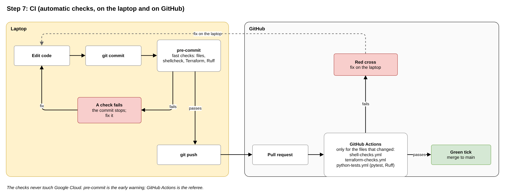

# Step 7: CI (the automatic checks, on the laptop and on GitHub)

**Planning file:** [07_ci.md](../architecture/07_ci.md)

**Status:** closed

**Built in:** phase 0 (pre-commit, S), phase 1 (shell checks, P), phase 2 (Terraform checks), phase 3 (Python tests); see [Timeline](#timeline-pre-commit-and-workflows-per-phase)

**Overview:** which checks to set up, where and in which phase ([Overview: pre-commit and GitHub Actions](#overview-pre-commit-and-github-actions)).

**Review:** how this step fits the story and the Data Engineering aim is at the end of this file ([Review](#review)).

<br>

## In plain words



**In one sentence:** automatic checks catch mistakes in the code before they reach `main`: first on the laptop, then on GitHub.

**How it works:** each time code is pushed to a pull request, GitHub starts a fresh computer, downloads the code and runs the checks. A green tick means all is well; a red cross shows what failed. On the laptop, pre-commit runs the fast checks at every `git commit`.

**Three things to know:**

- **The checks never touch Google Cloud.** Building and removing happen only on the laptop, so no password or key is ever stored on GitHub.
- **Only what changed is checked.** A README change starts no workflow; a SQL change starts only the Terraform checks.
- **Every check is a normal command.** A red cross on GitHub can be reproduced and fixed on the laptop.

<br>

## Overview: pre-commit and GitHub Actions

### Two kinds of checks

|                | pre-commit                                              | GitHub Actions                                   |
| -------------- | ------------------------------------------------------- | ------------------------------------------------ |
| **Runs where** | On the laptop                                           | On GitHub                                        |
| **Runs when**  | Every `git commit`                                      | Every pull request and push to `main`            |
| **Role**       | Early warning: catches problems before they leave the laptop | Referee: the final check; always runs       |
| **Set up in**  | One file: `.pre-commit-config.yaml`                     | One file per workflow: `.github/workflows/*.yml` |

### What to set up, and when

| Phase                    | pre-commit gets                                                                          | GitHub Actions gets                                         |
| ------------------------ | ---------------------------------------------------------------------------------------- | ----------------------------------------------------------- |
| **0** (now)              | General file checks: spaces, line endings, valid JSON and YAML, merge conflicts, large files, private keys | Nothing yet; switch on 2 settings: branch protection, push protection |
| **1** (bootstrap script) | `shellcheck`                                                                             | `shell-checks.yml`: ShellCheck                              |
| **2** (Terraform)        | Terraform format, validate, TFLint                                                       | `terraform-checks.yml`: format, validate, TFLint            |
| **3** (Python)           | Ruff (style and format)                                                                  | `python-tests.yml`: pytest and Ruff                         |
| **4 to 9**               | Nothing new                                                                              | Nothing new; everything above keeps running                 |

- **The rule:** each new language gets its check in both places, in the phase where its first file appears.
- **One difference:** pytest runs only on GitHub, not in pre-commit; it is slower.

### One-time laptop set-up (phase 0)

```bash
pip install -r requirements-dev.txt
pre-commit install
```

From then on, every `git commit` runs the hooks.

<br>

## Technical details

<br>

### What this step decides

| ID   | Decision                                                                                   |
| ---- | ------------------------------------------------------------------------------------------ |
| S7.1 | Offline checks only: no GCP credentials, no `plan`, no `apply`                             |
| S7.2 | The Terraform workflow runs `fmt`, `validate` and TFLint as steps of one job                |
| S7.3 | TFLint: `terraform` ruleset (`recommended` preset plus 3 rules) and `google` ruleset        |
| S7.4 | Workflows run on pull requests to `main` and pushes to `main`, filtered by changed paths    |
| S7.5 | The workflows' `GITHUB_TOKEN` has `contents: read` only                                    |
| S7.6 | Terraform, TFLint and plugin versions pinned; GitHub Actions pinned to a major version     |
| S7.7 | A second workflow runs pytest                                                              |
| S7.8 | Local checks use the same commands; pre-commit hooks optional                              |

<br>

### Refinements

P, Q, R and S: accepted.

| ID  | Finding | Proposal |
| --- | ------- | -------- |
| P   | **The first code of the project has no check.** Phase 1 writes `bootstrap.sh`; phase 5 writes `upload_data.sh`. Shell scripts fail in quiet ways (an unquoted variable, a missing `set -e`), and nothing checks them. **ShellCheck** is the standard linter for shell scripts and is already installed on GitHub's Ubuntu runners. | A third workflow, `shell-checks.yml`, from phase 1: `shellcheck bootstrap/*.sh scripts/*.sh`. |
| Q   | **The Python workflow misses two details.** It must install from `requirements-dev.txt` (N, step 6) and run when that file changes. Its Python version is not fixed. | Install with `pip install -r requirements-dev.txt`; add the file to the path filter; use the same Python version as the function's runtime (step 3.2). |
| R   | **Python style is not checked.** Only pytest runs. **Ruff** checks style and common mistakes, and formats code, in one tool. | Add `ruff check` and `ruff format --check` to `python-tests.yml`, and `ruff` to `requirements-dev.txt`. |
| S   | **pre-commit is optional in the plan (S7.8)**, but it gives the fastest feedback: on the laptop, at every commit. The maintainer used it in an earlier project. | Add `.pre-commit-config.yaml` in phase 0, with general file checks. Each later phase adds the hooks for its own language, in step with the workflows (see the timeline). pytest stays out: it is slower and runs in CI. |

<br>

### Do we need other workflows from the very start?

Answer to the maintainer's question.

| Candidate                                  | Verdict                | Why                                                                                   |
| ------------------------------------------ | ---------------------- | ------------------------------------------------------------------------------------- |
| **ShellCheck** for the scripts             | **Yes (P), phase 1**   | `bootstrap.sh` is the first code; a check costs one short file                         |
| **Ruff** for Python style                  | Optional (R), phase 3  | Code style rules, as in earlier projects; one more tool                                |
| A check of the dummy data's JSON           | No                     | The pytest tests load the dummy files from phase 3; a broken file fails them           |
| Markdown lint, link check                  | No                     | Documentation style; no Data Engineering value                                         |
| SQLFluff (SQL style)                       | No                     | The SQL files contain `templatefile()` placeholders it cannot parse without extra setup |
| Security scanner (Trivy, Checkov)          | No                     | Many findings to suppress with reasons; an optional extension                          |
| `terraform plan` on pull requests          | No                     | Needs cloud access from GitHub (S7.1); an optional extension                            |

**Before phase 1, nothing needs checking:** the repository holds only the dummy data and Claude's settings.

**GitHub settings, not workflows** (switched on once in the repository settings):

- **Branch protection on `main`:** changes reach `main` only through a pull request. Do **not** mark the workflows as "required checks": a workflow skipped by its path filter stays "pending" forever, and GitHub would then block the merge. The maintainer merges only on green ticks.
- **Secret scanning with push protection:** GitHub blocks a push that contains a key or password. Free for public repositories.

<br>

### Timeline: pre-commit and workflows per phase

| Phase | pre-commit hooks added (laptop, at each commit)                                  | GitHub workflow added (each pull request) | Other                                         |
| ----- | -------------------------------------------------------------------------------- | ----------------------------------------- | --------------------------------------------- |
| 0     | General file checks: trailing spaces, end of file, YAML, JSON, merge conflicts, large files, private keys | None                                      | `requirements-dev.txt` with `pre-commit`; GitHub settings: branch protection, push protection |
| 1     | `shellcheck`                                                                     | `shell-checks.yml`                        |                                               |
| 2     | `terraform_fmt`, `terraform_validate`, `terraform_tflint`                        | `terraform-checks.yml`                    | `.tflint.hcl`                                 |
| 3     | `ruff-check`, `ruff-format`                                                      | `python-tests.yml` (pytest, Ruff)         | `requirements-dev.txt` gains the function's requirements, `pytest`, `ruff` |
| 4-9   | None                                                                             | None                                      | All checks run on every commit and pull request |

- **Rule:** a language gets its pre-commit hook and its workflow in the same phase as its first file.
- **Phase 0 is still open:** its branch (`chore/repository-and-dummy-data`) is not pushed yet, so pre-commit can join it.

<br>

### Final implementation

#### `.pre-commit-config.yaml` (S, grows per phase)

| Phase | Hook repository                                  | Hooks                                                                                   |
| ----- | ------------------------------------------------ | --------------------------------------------------------------------------------------- |
| 0     | `pre-commit/pre-commit-hooks`                    | `trailing-whitespace`, `end-of-file-fixer`, `check-yaml`, `check-json`, `check-merge-conflict`, `check-added-large-files`, `detect-private-key` |
| 1     | `koalaman/shellcheck-precommit`                  | `shellcheck`                                                                            |
| 2     | `antonbabenko/pre-commit-terraform`              | `terraform_fmt`, `terraform_validate`, `terraform_tflint`                               |
| 3     | `astral-sh/ruff-pre-commit`                      | `ruff-check`, `ruff-format`                                                             |

- **`data/` excluded from the fixers** (`trailing-whitespace`, `end-of-file-fixer`): the dummy data stays exactly as exported. `check-json` still checks it.
- **Versions:** each hook repository pinned with `rev`; updated with `pre-commit autoupdate`.
- **Set-up once per laptop:** `pip install -r requirements-dev.txt`, then `pre-commit install`. From then on, `git commit` runs the hooks.
- **Terraform hooks need Terraform and TFLint installed on the laptop.**

#### All workflows

| Setting       | Value                                                                       |
| ------------- | --------------------------------------------------------------------------- |
| `on`          | `pull_request` to `main`, `push` to `main`, each with its own `paths` filter |
| `permissions` | `contents: read`                                                            |
| Runner        | `ubuntu-latest`                                                             |
| Actions       | Pinned to a major version (for example `actions/checkout@v4`); exact versions set at implementation |

#### `.github/workflows/shell-checks.yml` (P, phase 1)

| Paths                                       | Steps                                           |
| ------------------------------------------- | ----------------------------------------------- |
| `bootstrap/**`, `scripts/**`, the workflow file | Checkout; `shellcheck bootstrap/*.sh scripts/*.sh` |

#### `.github/workflows/terraform-checks.yml` (phase 2)

| Paths                                           | Steps                                                                                     |
| ----------------------------------------------- | ----------------------------------------------------------------------------------------- |
| `terraform/**`, `.tflint.hcl`, the workflow file | Checkout; install Terraform (pinned); `terraform fmt -check -recursive`; in `terraform/deployment/`: `terraform init -backend=false`, `terraform validate`; install TFLint (pinned); `tflint --init` (with `GITHUB_TOKEN`); `tflint --recursive` |

- **`init -backend=false`:** loads the providers and the module, skips the state bucket, so no login is needed.
- **One `validate` checks both folders:** the deployment calls the module.

#### `.tflint.hcl` (phase 2)

| Block                        | Setting                                                                  |
| ---------------------------- | ------------------------------------------------------------------------ |
| `plugin "terraform"`         | `preset = "recommended"`, pinned `version`                                |
| `rule` blocks                | `terraform_naming_convention`, `terraform_documented_variables`, `terraform_documented_outputs` enabled |
| `plugin "google"`            | Enabled, pinned `version`, no deep checking                               |

#### `.github/workflows/python-tests.yml` (phase 3, with R)

| Paths                                                                                         | Steps                                                                                |
| --------------------------------------------------------------------------------------------- | ------------------------------------------------------------------------------------ |
| `terraform/modules/content_pipeline/function/**`, `tests/**`, `data/dummy/**`, `pyproject.toml`, `requirements-dev.txt` (Q), the workflow file | Checkout; install Python (same version as the function's runtime, Q); `pip install -r requirements-dev.txt` (Q); `pytest`; `ruff check`; `ruff format --check` |

#### Local commands (README)

| Check            | Command                                              | Run from                |
| ---------------- | ---------------------------------------------------- | ----------------------- |
| Shell scripts    | `shellcheck bootstrap/*.sh scripts/*.sh`             | Repository root         |
| Format           | `terraform fmt -check -recursive`                    | Repository root         |
| Initialise       | `terraform init -backend=false`                      | `terraform/deployment/` |
| Validate         | `terraform validate`                                 | `terraform/deployment/` |
| Lint             | `tflint --init`, then `tflint --recursive`           | Repository root         |
| Python tests     | `pytest`                                             | Repository root         |

#### Done when

- **Phase 1:** `shell-checks.yml` passes on the pull request that adds `bootstrap.sh`.
- **Phase 2:** `terraform-checks.yml` passes.
- **Phase 3:** `python-tests.yml` passes.

<br>

### Check at implementation

- **P:** that ShellCheck is still preinstalled on `ubuntu-latest`; if not, install it with `apt-get` in the workflow.
- **S:** whether the `terraform_validate` hook runs `terraform init` by itself, or needs `init` run once by hand.

<br>

## Review

**Fits the story:** yes. CI checks Team B's code only and never touches Team A's project. No cloud access from GitHub means no keys to protect.

**Fits the Data Engineering aim:** yes. Automatic checks on every change are a standard engineering habit. The Python tests guard the only custom code that transforms data. A read-only token applies least privilege (step 4) to CI too.

**Simplest choice:** offline checks only; one job per workflow; no `plan` from GitHub.

**P. The first script has no check (accepted).** `bootstrap.sh` (phase 1) is the project's first code, but the plan's first workflow arrives in phase 2. ShellCheck catches common bash mistakes, and GitHub's computers already have it.
→ A third small workflow from phase 1.

**Q. Two missing details in the Python workflow (accepted).** It must install from `requirements-dev.txt` (step 6) and use the same Python version as the function.

**R. Python style (accepted).** Ruff checks style and common mistakes, like the coding guidelines of earlier projects.

**S. pre-commit from phase 0 (accepted).** The fastest feedback: the checks run on the laptop at every `git commit`, before anything reaches GitHub. It starts with general file checks in phase 0 and grows with each language, in step with the workflows (see the timeline). CI stays the referee.

**Other workflows from the very start?** Not needed: before phase 1 there is no code to check. The useful additions are ShellCheck (P) from phase 1 and, optionally, Ruff (R) from phase 3. Two GitHub settings help from day one: branch protection on `main` and push protection for secrets.
